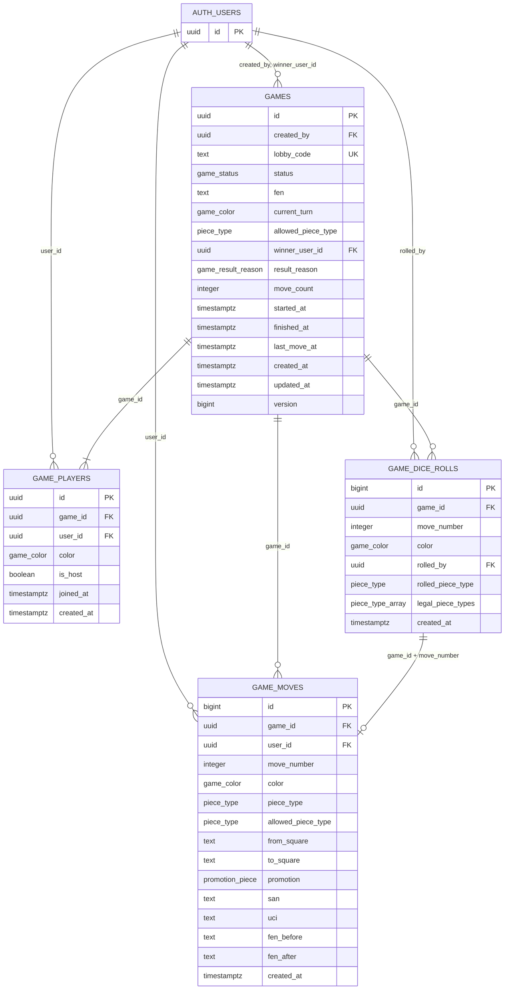

# Zarlı Satranç veritabanı şeması

Hedef: PostgreSQL (Supabase). Kaynak: [`migrations/`](migrations/) (001-005, sırayla).

## Diyagram

## Enum'lar

| Enum | Değerler |
|---|---|
| `game_status` | `waiting`, `active`, `finished`, `cancelled` |
| `game_color` | `w`, `b` |
| `piece_type` | `p`, `n`, `b`, `r`, `q`, `k` |
| `promotion_piece` | `n`, `b`, `r`, `q` |
| `game_result_reason` | `checkmate`, `stalemate`, `draw`, `resign`, `timeout`, `abandon` |

`cancelled`, `timeout` ve `abandon` kodun tiplerinde ve arayüz metinlerinde var, ama şu an onları üreten bir akış yok.

## Tablolar

### `games`

Lobi ve maç aynı kayıttır. Anlık oyun durumu burada tutulur, sayfa yenilenince oyun buradan devam eder.

| Kolon | Tip | Null? | Default | Açıklama |
|---|---|---|---|---|
| `id` | `uuid` | hayır | `gen_random_uuid()` | Birincil anahtar, `/game/[id]` adresindeki değer |
| `created_by` | `uuid` | evet | | Lobiyi kuran kullanıcı; kullanıcı silinirse `NULL` |
| `lobby_code` | `text` | hayır | | 6 karakterlik benzersiz kod (`I`, `O`, `0`, `1` içermez) |
| `status` | `game_status` | hayır | `'waiting'` | Oyunun aşaması |
| `fen` | `text` | hayır | başlangıç dizilimi | Anlık tahta durumu |
| `current_turn` | `game_color` | hayır | `'w'` | Sırası gelen renk |
| `allowed_piece_type` | `piece_type` | evet | | Bu turun zar sonucu; zar atılmadıysa veya oyun aktif değilse `NULL` |
| `winner_user_id` | `uuid` | evet | | Kazanan; beraberlikte veya kullanıcı silinirse `NULL` |
| `result_reason` | `game_result_reason` | evet | | Bitiş sebebi; `finished` durumunda zorunlu |
| `move_count` | `integer` | hayır | `0` | Yapılan hamle sayısı |
| `started_at` | `timestamptz` | evet | | İkinci oyuncunun katılıp oyunun başladığı an |
| `finished_at` | `timestamptz` | evet | | Bitiş anı; `finished` durumunda zorunlu |
| `last_move_at` | `timestamptz` | evet | | Son hamle veya zar anı |
| `created_at` | `timestamptz` | hayır | `now()` | Oluşturulma anı |
| `updated_at` | `timestamptz` | hayır | `now()` | Tetikleyiciyle her güncellemede yenilenir |
| `version` | `bigint` | hayır | `1` | Her güncellemede 1 artar; istemci eski ve yinelenen mesajları bununla ayıklar |

### `game_players`

Bir oyundaki koltuklar. `(game_id, color)` benzersiz olduğu için bir oyunda en fazla 2 oyuncu olabilir.

| Kolon | Tip | Null? | Default | Açıklama |
|---|---|---|---|---|
| `id` | `uuid` | hayır | `gen_random_uuid()` | Birincil anahtar |
| `game_id` | `uuid` | hayır | | Oyun; oyun silinirse kayıt da silinir |
| `user_id` | `uuid` | evet | | Oyuncu; kullanıcı silinirse `NULL`, koltuk kalır |
| `color` | `game_color` | hayır | | Oyuncunun rengi |
| `is_host` | `boolean` | hayır | `false` | Lobiyi kuran oyuncu mu |
| `joined_at` | `timestamptz` | hayır | `now()` | Katılma anı |
| `created_at` | `timestamptz` | hayır | `now()` | Oluşturulma anı |

### `game_dice_rolls`

Sıralı zar geçmişi. Yalnızca eklenir, güncellenmez. `(game_id, move_number)` benzersizdir.

| Kolon | Tip | Null? | Default | Açıklama |
|---|---|---|---|---|
| `id` | `bigint` | hayır | identity | Birincil anahtar |
| `game_id` | `uuid` | hayır | | Oyun; oyun silinirse kayıt da silinir |
| `move_number` | `integer` | hayır | | Bu zarın belirlediği hamlenin numarası (1'den başlar) |
| `color` | `game_color` | hayır | | Zarın ait olduğu turun rengi |
| `rolled_by` | `uuid` | evet | | Zarı atan oyuncu. Birinci turdan sonraki zarları bir önceki hamleyi yapan istemci attığı için çoğu zaman rakiptir |
| `rolled_piece_type` | `piece_type` | hayır | | Çıkan taş türü; `legal_piece_types` içinde olmak zorunda |
| `legal_piece_types` | `piece_type[]` | hayır | | Zar atıldığı andaki seçenekler |
| `created_at` | `timestamptz` | hayır | `now()` | Zarın atıldığı an |

### `game_moves`

Sıralı hamle geçmişi. Yalnızca eklenir, güncellenmez. `(game_id, move_number)` benzersizdir ve `game_dice_rolls` kaydına bağlıdır, yani zarsız hamle yazılamaz.

| Kolon | Tip | Null? | Default | Açıklama |
|---|---|---|---|---|
| `id` | `bigint` | hayır | identity | Birincil anahtar |
| `game_id` | `uuid` | hayır | | Oyun; oyun silinirse kayıt da silinir |
| `user_id` | `uuid` | evet | | Hamleyi yapan; kullanıcı silinirse `NULL` |
| `move_number` | `integer` | hayır | | Oyun içindeki sıra (1'den başlar) |
| `color` | `game_color` | hayır | | Hamleyi yapan renk |
| `piece_type` | `piece_type` | hayır | | Oynanan taş; `allowed_piece_type` ile aynı olmak zorunda |
| `allowed_piece_type` | `piece_type` | hayır | | Hamle anındaki zar sonucu |
| `from_square` | `text` | hayır | | Çıkış karesi (`e2` biçiminde) |
| `to_square` | `text` | hayır | | Varış karesi (`e4` biçiminde) |
| `promotion` | `promotion_piece` | evet | | Terfi taşı |
| `san` | `text` | evet | | Cebirsel gösterim |
| `uci` | `text` | evet | | UCI gösterimi |
| `fen_before` | `text` | hayır | | Hamleden önceki tahta |
| `fen_after` | `text` | hayır | | Hamleden sonraki tahta |
| `created_at` | `timestamptz` | hayır | `now()` | Hamle anı |

## İlişkiler

- Bir `games` kaydının en fazla iki `game_players` kaydı olur.
- Bir `games` kaydının çok sayıda `game_moves` ve `game_dice_rolls` kaydı olur.
- Bir `game_moves` kaydının `game_id + move_number` üzerinden tam olarak bir `game_dice_rolls` kaydı olur. Bir zarın henüz hamlesi olmayabilir, örneğin oyuncu zar geldikten sonra pes ettiyse.
- Bir kullanıcının (`auth.users`) çok sayıda oyunu, hamlesi ve zarı olabilir.
- Bir oyun silinirse oyuncuları, hamleleri ve zarları da silinir.
- Bir kullanıcı silinirse oyun geçmişi korunur, ilgili kolonlar `NULL` olur. Böylece rakibin geçmişi bozulmaz.

Replay: `game_moves` kayıtlarını `move_number` sırasıyla okumak yeterlidir (`getGameMoves`). Her turun zarı aynı `move_number` ile `game_dice_rolls` tablosundadır (`getGameDiceRolls`).

## Yazma fonksiyonları

| Fonksiyon | Veri katmanı | İşi |
|---|---|---|
| `create_game` | `createGame` | Lobi ve host oyuncuyu birlikte oluşturur |
| `join_game` | `joinGame` | Oyunu kilitleyerek katılır, ikinci oyuncuda oyunu başlatır |
| `join_game_by_code` | `joinGameByCode` | Lobi koduyla katılır |
| `save_dice_roll` | `saveDiceRoll` | Turun zarını kaydeder |
| `record_move` | `saveMove` | Hamleyi, yeni durumu ve sonraki zarı tek transaction'da yazar |
| `finish_game` | `finishGame` | Pes etmeyle bitirir, rakibi kazanan yapar |
| `get_player_stats` | `getPlayerStats` | Oyuncunun oynadığı oyun, galibiyet, mağlubiyet ve beraberlik sayıları |

Tekrarlanabilirlik: `record_move`, `save_dice_roll` ve `finish_game` aynı isteğin tekrarını ikinci kez yazmaz, güncel durumu döner. Böylece yanıtı ağda kaybolan istek güvenle yeniden gönderilir. `record_move` tekrarı `duplicate: true` ile bildirir; aynı numaraya farklı bir hamle reddedilir.

`cleanup_stale_lobbies` istemciden çağrılamaz. `pg_cron` onu 10 dakikada bir çalıştırır (`cleanup-stale-lobbies`) ve 30 dakikadan uzun süre `waiting` durumunda kalan lobileri siler.

## RLS özeti

| Tablo | Okuma | Doğrudan yazma |
|---|---|---|
| `games` | Yalnızca o oyunun oyuncuları | Yok |
| `game_players` | Yalnızca o oyunun oyuncuları | Yok |
| `game_dice_rolls` | Yalnızca o oyunun oyuncuları | Yok |
| `game_moves` | Yalnızca o oyunun oyuncuları | Yok |

- Policy'ler `private.is_game_player` fonksiyonunu kullanır. `private` şeması API'den yayınlanmaz.
- Yazmalar yalnızca yukarıdaki fonksiyonlardan geçer. "Hamleyi sadece sırası gelen oyuncu ekleyebilir" kuralı `record_move` içinde uygulanır, çünkü hamle ile oyun durumu birlikte değişmelidir. INSERT policy'si tek başına bunu sağlayamazdı.
- Fonksiyonlar oturum, oyunculuk, oyun durumu, sıra, hamle numarası ve zara uygunluğu oyun satırını kilitleyerek denetler.
- Anonim oturumlar `authenticated` rolüyle çalışır. `anon` rolünün tablo ve fonksiyon yetkisi yoktur.
- Oyuncusu olunmayan bir oyun "bulunamadı" görünür. Bu nedenle `/game/[id]` bağlantısıyla izleyici olarak girilemez; katılım lobi koduyla olur.

### Bilinen sınır

Satranç kuralları ve zar sonucu istemcide (`chess.js`, `Math.random`) üretilir, SQL bunları doğrulayamaz. Değiştirilmiş bir istemci, kendi sırasında geçersiz bir FEN yazabilir, zarı seçebilir veya haksız yere mat ilan edebilir. Bunu kapatmak için doğrulamanın sunucuya taşınması gerekir.

## Realtime

`supabase_realtime` publication'ında yalnızca `games` tablosu vardır. İstemci `game-fast-<id>` kanalını kullanır:

- `postgres_changes`: `games` satırının güncellemeleri. RLS uygulanır, yalnızca oyuncular alır.
- Broadcast (`state_sync`): aynı durumu daha hızlı iletir. Kaybolması sorun değildir.
- Presence: rakibin bağlı olup olmadığını gösterir.

Üç kaynak ve DB okumaları `version` ile birleştirilir; yalnızca daha yeni sürüm uygulanır.
